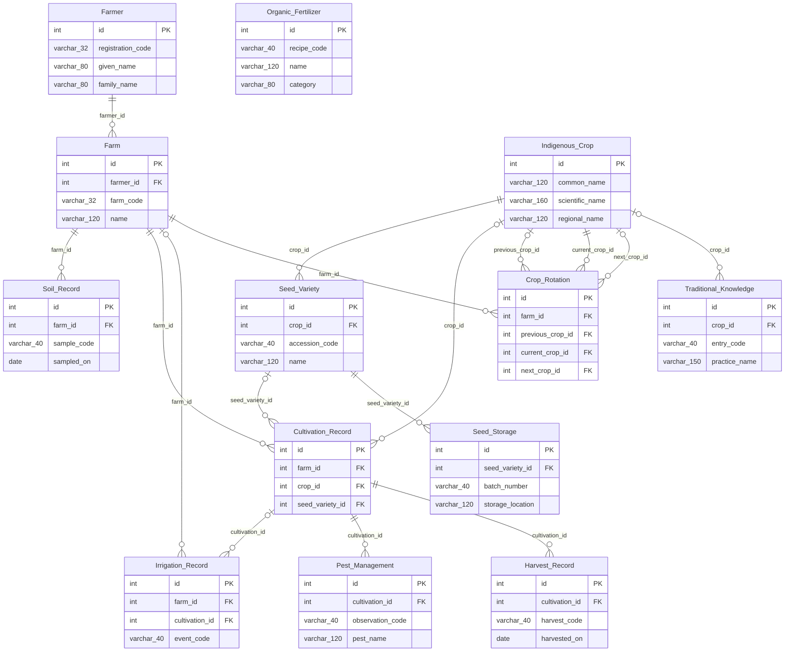

# Entity relationship diagrams

Generated from the actual DDL. A child may reference an optional parent when its FK is nullable.
Cultivation and irrigation each enforce exactly one of their two alternative references.
A farm and a crop can each participate in many cultivations.

## Presentation diagram

## Complete diagram

```mermaid
erDiagram
    Farmer {
        int id PK
        varchar_32 registration_code
        varchar_80 given_name
        varchar_80 family_name
        varchar_254 email
        varchar_30 phone
        varchar_100 village
        varchar_100 block_name
        varchar_100 district
        varchar_100 state_name
        varchar_10 postal_code
        varchar_60 preferred_language
        smallint farming_since_year
        smallint indigenous_since_year
        varchar_80 education_level
        varchar_160 training_topic
        varchar_160 training_provider
        date training_completed_on
        varchar_100 specialization
        varchar_100 management_role
        text knowledge_participation
        boolean contact_consent
        date registered_on
        enum__pending___verified___declined verification_status
        date verified_on
        boolean synthetic
    }
    Farm {
        int id PK
        int farmer_id FK
        varchar_32 farm_code
        varchar_120 name
        varchar_100 village
        varchar_100 district
        varchar_100 state_name
        decimal_8_5 latitude
        decimal_8_5 longitude
        decimal_10_2 land_area_ha
        decimal_10_2 cultivable_area_ha
        varchar_70 tenure
        decimal_8_2 elevation_m
        varchar_80 terrain
        varchar_80 climate_zone
        varchar_80 baseline_soil
        varchar_100 water_availability
        varchar_100 water_source
        text irrigation_infrastructure
        varchar_100 farming_system
        varchar_100 organic_certificate
        varchar_120 certification_body
        date certificate_expires_on
        enum__active___fallow___archived land_use
        timestamp created_at
        timestamp updated_at
    }
    Indigenous_Crop {
        int id PK
        varchar_120 common_name
        varchar_160 scientific_name
        varchar_120 regional_name
        varchar_80 regional_language
        varchar_80 category
        varchar_120 origin_region
        text historical_region_notes
        enum__kharif___rabi___zaid___perennial growing_season
        varchar_100 climate
        decimal_5_2 min_temp_c
        decimal_5_2 max_temp_c
        decimal_8_2 min_rainfall_mm
        decimal_8_2 max_rainfall_mm
        varchar_100 preferred_soil
        smallint_unsigned growth_days
        varchar_80 edible_part
        text traditional_uses
        text nutrition_notes
        varchar_80 pollination
        varchar_100 propagation_method
        varchar_100 drought_response
        text cultivation_notes
        varchar_80 conservation_status
        text conservation_notes
        varchar_500 reference_url
    }
    Seed_Variety {
        int id PK
        int crop_id FK
        varchar_40 accession_code
        varchar_120 name
        varchar_120 origin_region
        varchar_120 origin_locality
        varchar_60 seed_colour
        varchar_60 seed_shape
        decimal_6_2 seed_length_mm
        decimal_9_3 thousand_seed_mass_g
        decimal_5_2 germination_pct
        smallint_unsigned germination_days
        decimal_5_2 purity_pct
        decimal_5_2 moisture_target_pct
        decimal_5_2 storage_max_temp_c
        decimal_5_2 storage_max_rh_pct
        varchar_100 storage_container
        text dormancy_notes
        text seed_treatment
        smallint_unsigned expected_viability_months
        varchar_80 conservation_status
        text sourcing_notes
        varchar_120 multiplication_method
        date documentation_date
        varchar_250 documentation_source
        boolean synthetic
    }
    Soil_Record {
        int id PK
        int farm_id FK
        varchar_40 sample_code
        date sampled_on
        varchar_80 plot_label
        decimal_6_2 depth_top_cm
        decimal_6_2 depth_bottom_cm
        varchar_80 texture
        varchar_100 structure_description
        decimal_4_2 ph
        decimal_7_3 ec_ds_m
        decimal_9_2 nitrogen_mg_kg
        decimal_9_2 phosphorus_mg_kg
        decimal_9_2 potassium_mg_kg
        decimal_5_2 organic_carbon_pct
        decimal_5_2 moisture_pct
        decimal_5_2 water_holding_pct
        varchar_80 drainage
        decimal_9_3 zinc_mg_kg
        decimal_9_3 iron_mg_kg
        decimal_9_3 boron_mg_kg
        enum__low___medium___high fertility
        varchar_120 lab_name
        varchar_120 analysis_method
        text management_recommendation
    }
    Cultivation_Record {
        int id PK
        int farm_id FK
        int crop_id FK
        int seed_variety_id FK
        varchar_40 cultivation_code
        date sowing_date
        enum__kharif___rabi___zaid___perennial season
        varchar_80 plot_label
        text land_preparation
        varchar_100 sowing_method
        decimal_12_3 seed_quantity
        enum__kg___g___count seed_unit
        decimal_7_2 row_spacing_cm
        decimal_7_2 plant_spacing_cm
        decimal_10_2 area_ha
        date germination_observed_on
        decimal_5_2 germination_pct
        text weed_management
        text traditional_technique
        varchar_100 growth_stage
        date stage_observed_on
        date expected_harvest_date
        enum__planned___active___completed___abandoned status
        text weather_notes
        text field_notes
    }
    Irrigation_Record {
        int id PK
        int farm_id FK
        int cultivation_id FK
        varchar_40 event_code
        date irrigated_on
        time started_at
        varchar_100 method
        varchar_160 traditional_technique
        varchar_100 water_source
        decimal_12_2 quantity_l
        smallint_unsigned duration_minutes
        varchar_100 distribution_method
        decimal_5_2 moisture_before_pct
        decimal_5_2 moisture_after_pct
        varchar_100 water_availability
        text efficiency_observations
        text maintenance_notes
        text environmental_notes
        varchar_80 plot_label
        decimal_10_2 irrigated_area_ha
        decimal_7_3 water_ec_ds_m
        decimal_10_3 pumping_energy_kwh
        boolean runoff_observed
        varchar_100 channel_condition
        date next_inspection_on
    }
    Organic_Fertilizer {
        int id PK
        varchar_40 recipe_code
        varchar_120 name
        varchar_80 category
        text preparation_method
        text main_ingredients
        smallint_unsigned preparation_days
        text fermentation_conditions
        varchar_120 mixing_schedule
        text maturity_indicators
        text application_method
        decimal_10_3 application_rate
        varchar_50 application_rate_unit
        varchar_100 application_timing
        text storage_conditions
        smallint_unsigned shelf_life_days
        decimal_5_2 nitrogen_pct
        decimal_5_2 phosphorus_pct
        decimal_5_2 potassium_pct
        varchar_100 nutrient_basis
        varchar_120 region
        text safety_precautions
        varchar_350 source_reference
        date documentation_date
        boolean synthetic
    }
    Pest_Management {
        int id PK
        int cultivation_id FK
        varchar_40 observation_code
        varchar_120 pest_name
        varchar_80 pest_category
        text symptoms
        enum__low___medium___high severity
        date observed_on
        decimal_10_2 affected_area_ha
        varchar_120 identification_method
        varchar_120 treatment_name
        text treatment_ingredients
        text preparation_method
        text application_method
        date applied_on
        decimal_10_3 application_quantity
        varchar_40 application_unit
        varchar_140 frequency_notes
        text effectiveness_observation
        date follow_up_on
        text follow_up_notes
        text safety_notes
        enum__historical___field_observation___controlled_study evidence_level
        varchar_350 evidence_reference
        boolean synthetic
    }
    Harvest_Record {
        int id PK
        int cultivation_id FK
        varchar_40 harvest_code
        date harvested_on
        varchar_100 harvest_method
        decimal_10_2 harvested_area_ha
        decimal_12_3 gross_yield
        decimal_12_3 net_yield
        enum__kg___count yield_unit
        decimal_5_2 moisture_pct
        varchar_80 quality_grade
        text loss_cause
        varchar_100 storage_method
        varchar_120 storage_location
        decimal_13_2 estimated_value_inr
        text processing_method
        text preservation_method
        enum__recorded___stored___distributed status
        decimal_8_2 labour_hours
        text weather_notes
        varchar_120 equipment
        smallint_unsigned drying_days
        varchar_120 grading_method
        varchar_120 destination
        text field_notes
    }
    Seed_Storage {
        int id PK
        int seed_variety_id FK
        varchar_40 batch_number
        varchar_120 storage_location
        varchar_100 container
        decimal_12_3 initial_quantity
        decimal_12_3 current_quantity
        enum__kg___g___count quantity_unit
        decimal_12_3 low_stock_threshold
        date stored_on
        date expected_expiry_on
        decimal_5_2 temperature_c
        decimal_5_2 humidity_pct
        decimal_5_2 moisture_pct
        date germination_tested_on
        decimal_5_2 germination_pct
        smallint_unsigned germination_sample_size
        date pest_inspected_on
        text pest_findings
        text preservation_technique
        enum__available___quarantined___retired status
        text condition_notes
        text inspection_history
        date last_condition_check_on
        json quantity_history
    }
    Crop_Rotation {
        int id PK
        int farm_id FK
        int previous_crop_id FK
        int current_crop_id FK
        int next_crop_id FK
        varchar_40 plan_code
        varchar_80 plot_label
        date start_date
        date end_date
        smallint_unsigned cycle_year
        enum__kharif___rabi___zaid___perennial season
        varchar_150 objective
        text nitrogen_management
        text pest_objective
        text cover_crop_notes
        text traditional_practice
        text soil_observations
        enum__planned___active___completed___cancelled status
        text residue_management
        smallint_unsigned fallow_days
        text weed_pressure_notes
        decimal_8_2 water_budget_mm
        date review_on
        text review_notes
        decimal_10_2 planned_area_ha
    }
    Traditional_Knowledge {
        int id PK
        int crop_id FK
        varchar_40 entry_code
        varchar_150 practice_name
        varchar_80 category
        varchar_120 origin_region
        varchar_180 community_attribution
        varchar_120 traditional_term
        varchar_80 terminology_language
        text description
        text historical_background
        text materials
        text procedure_notes
        varchar_100 seasonal_relevance
        text environmental_conditions
        varchar_250 oral_reference
        varchar_350 written_source
        date documented_on
        enum__unverified___source_reviewed___community_reviewed verification_status
        varchar_160 custodian
        enum__public___restricted access_level
        text consent_basis
        text reuse_terms
        text limitations
        boolean synthetic
    }
    Farmer ||--o{ Farm : farmer_id
    Indigenous_Crop ||--o{ Seed_Variety : crop_id
    Farm ||--o{ Soil_Record : farm_id
    Farm ||--o{ Cultivation_Record : farm_id
    Indigenous_Crop o|--o{ Cultivation_Record : crop_id
    Seed_Variety o|--o{ Cultivation_Record : seed_variety_id
    Farm o|--o{ Irrigation_Record : farm_id
    Cultivation_Record o|--o{ Irrigation_Record : cultivation_id
    Cultivation_Record ||--o{ Pest_Management : cultivation_id
    Cultivation_Record ||--o{ Harvest_Record : cultivation_id
    Seed_Variety ||--o{ Seed_Storage : seed_variety_id
    Farm ||--o{ Crop_Rotation : farm_id
    Indigenous_Crop o|--o{ Crop_Rotation : previous_crop_id
    Indigenous_Crop ||--o{ Crop_Rotation : current_crop_id
    Indigenous_Crop o|--o{ Crop_Rotation : next_crop_id
    Indigenous_Crop o|--o{ Traditional_Knowledge : crop_id
```

